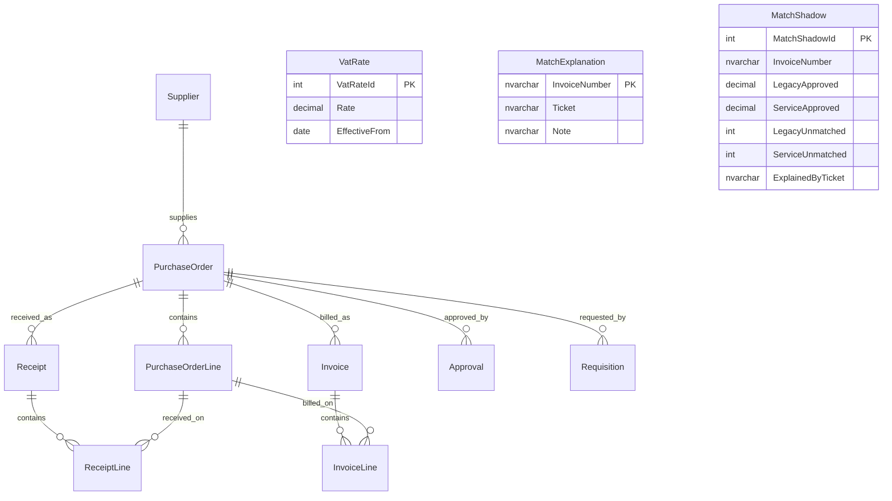

# Northline estate

The match reads the supplier, order, receipt, and invoice tables.
Approval, requisition, and VAT are human records. The match service does not read them.
MatchExplanation and MatchShadow store an invoice number as text. They have no foreign key to Invoice.

