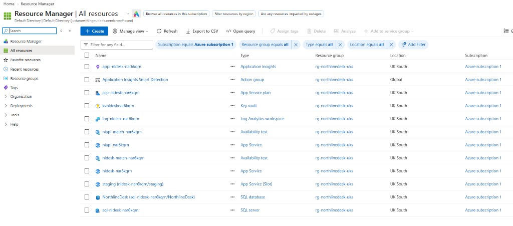

# Azure and GitHub, once

The apps run in Azure. The repository stays on GitHub. GitHub Actions deploys with a federated credential, so there is no client secret in the repo or in an app setting.

Do this before the first deploy. The names below are the ones to create. The resource names inside the group are generated by Bicep.

## 1. Resource group

```bash
az group create --name rg-northlinedesk-uks --location uksouth
```

The workflow stops if the group is not in `uksouth`.

## 2. App registration

Create an app registration, for example `northline-github`.

Copy two identifiers:

- Application (client) ID → GitHub secret `AZURE_CLIENT_ID`
- Directory (tenant) ID → GitHub secret `AZURE_TENANT_ID`
- On the Enterprise application, the Object ID → GitHub secret `AZURE_OBJECT_ID`

The object id is not the client id. Bicep puts the object id on the Key Vault access policy so the workflow can write secrets.

## 3. Federated credentials

Add two federated credentials on the app registration. Replace `ORG/REPO` with the GitHub repository.

| Credential name | Subject |
| --- | --- |
| `github-staging` | `repo:ORG/REPO:environment:staging` |
| `github-production` | `repo:ORG/REPO:environment:production` |

Issuer: `https://token.actions.githubusercontent.com`. Audience: `api://AzureADTokenExchange`.

## 4. Role

Grant the enterprise application **Contributor** on `rg-northlinedesk-uks`. Contributor on that group is enough. The template does not use a role assignment. Key Vault uses an access policy, which is part of the vault resource.

## 5. GitHub secrets

| Secret | Value |
| --- | --- |
| `AZURE_CLIENT_ID` | Application (client) ID |
| `AZURE_TENANT_ID` | Tenant ID |
| `AZURE_SUBSCRIPTION_ID` | Subscription ID |
| `AZURE_OBJECT_ID` | Enterprise application object ID |
| `AZURE_RESOURCE_GROUP` | `rg-northlinedesk-uks` |
| `SQL_ADMIN_PASSWORD` | A password you generate. It is stored in Key Vault as part of the connection string. It is not an app setting. |
| `SHADOW_KEY` | A second generated secret. The pipeline sends it as `X-Shadow-Key`. |
| `BUDGET_EMAIL` | Optional. Your address, if you want the £40 budget alert. |

## 6. GitHub environments

Create `staging` with no required reviewer. Deploy uses it.

Create `production` and add yourself as a required reviewer **before** the first promote. Promote and reset use it. If the environment is created by the first workflow run, it will not wait for you until you add the reviewer.

## 7. What you pay for

P0v3 is one core and 4 GB, shared by the desk, the staging slot, and the API. Stopping the apps does not stop the plan charge.

Auto-pause on Azure SQL cannot be shorter than 60 minutes. App Service calls `/health` every minute, and that interval cannot be changed, so `/health` does not open SQL. Application Insights standard tests only allow 5, 10, or 15 minutes, which is too often for the pause, so both tests are disabled. Their location id is `emea-ru-msa-edge`. That tag is historical. In the portal the location is UK South. `.github/workflows/daily-live.yml` runs the Match page and `POST /match` once a day, and you can run it by hand before a call. After an hour with no visitor the vCore meter stops. The plan charge continues until the resource group is deleted. The first request after a pause waits up to 90 seconds for the database to resume.

The cost reading is in `docs/cost.md`: signed up Sunday 25 October 2026, and £20.07 by 05:45 UK time on Wednesday 28 October, the fourth day. Delete the resource group when the live pages are no longer needed:

```bash
az group delete --name rg-northlinedesk-uks --yes
```

`budgetStart` in `infra/main.bicepparam` must be the first day of the current month when you deploy.

## What was deployed

Captured on 23 November 2026, while `rg-northlinedesk-uks` was still in the subscription. The Bicep token in the names is `nar6kqrn`. Everything in the list is in UK South, except the Application Insights Smart Detection action group, which the portal showed as Global.

| Resource | Name |
| --- | --- |
| Desk | `nldesk-nar6kqrn` |
| Staging slot | `nldesk-nar6kqrn/staging` |
| Match API | `nlapi-nar6kqrn` |
| App Service plan | `asp-nldesk-nar6kqrn` |
| SQL server | `sql-nldesk-nar6kqrn` |
| SQL database | `NorthlineDesk` |
| Key Vault | `kvnldesknar6kqrn` |
| Log Analytics workspace | `log-nldesk-nar6kqrn` |
| Application Insights | `appi-nldesk-nar6kqrn` |
| Desk availability test | `nldesk-match-nar6kqrn` |
| API availability test | `nlapi-match-nar6kqrn` |



The hosts were:

- https://nldesk-nar6kqrn.azurewebsites.net
- https://nldesk-nar6kqrn-staging.azurewebsites.net
- https://nlapi-nar6kqrn.azurewebsites.net

The pages those hosts returned are in the README and in `docs/cutover.md`. The subscription credit banner that afternoon showed £35.01 remaining, expiring 24 November 2026. That figure is the free-credit balance. It is not the cost of this group. See `docs/cost.md`.