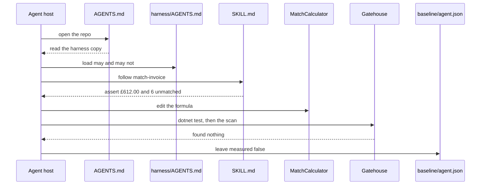

# Harness flow

A host opens the repo and reads the root `AGENTS.md` before an agent edits anything. That page points at `harness/AGENTS.md`. The skill then sets the order for a match change.

The agent may edit `MatchCalculator` and its tests. A person records ticket `partial-receipt`, approves production, and swaps the slot. Migration 002 runs after that swap.

## A match change

`baseline/manual.json` is the same shape for a change made by hand. Both files stay unmeasured until a session is timed.

The MCP call is a separate path, in `spec/mcp-flow.md`. The host may call `match_invoice` and receive £612.00. That call does not record the ticket and does not swap the slot.