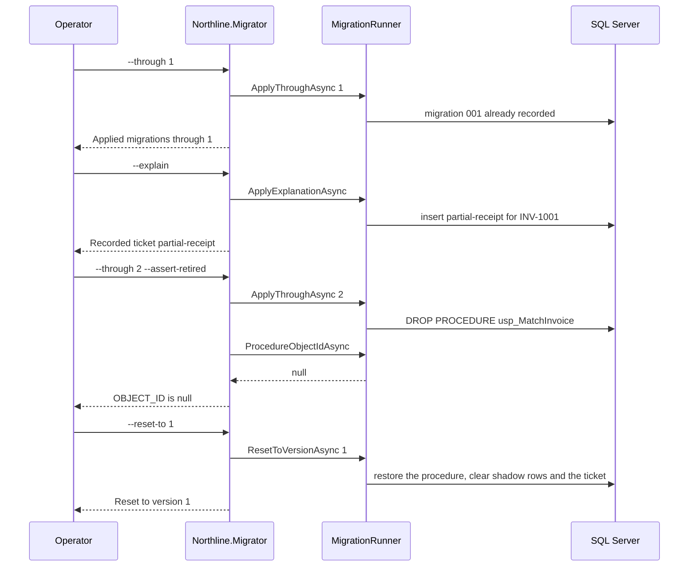

# Migrator flow

`tools/Northline.Migrator` applies the scripts by calling `MigrationRunner`. The container for this rehearsal starts on version 1, so `dbo.usp_MatchInvoice` is present.

## Rehearse on the local container

`--through 1` is what a deploy applies. The procedure stays. `--explain` followed by `--through 2 --assert-retired` is what a promotion applies. `--reset-to 1` is only the rehearsal. A real promotion does not put the procedure back.

The promote job posts `/shadow/INV-1001` and continues only when `promotionBlocked` is false, before it calls `--through 2`.