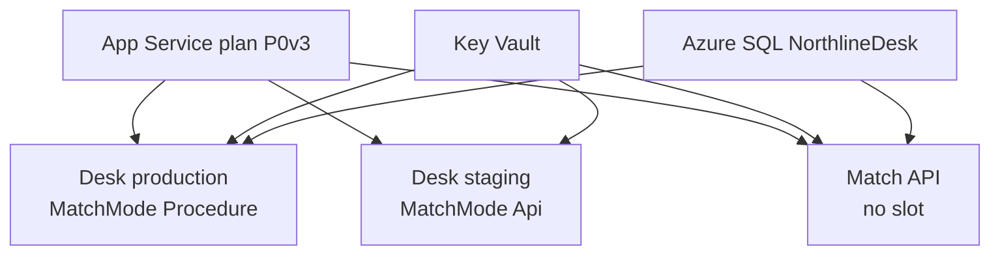
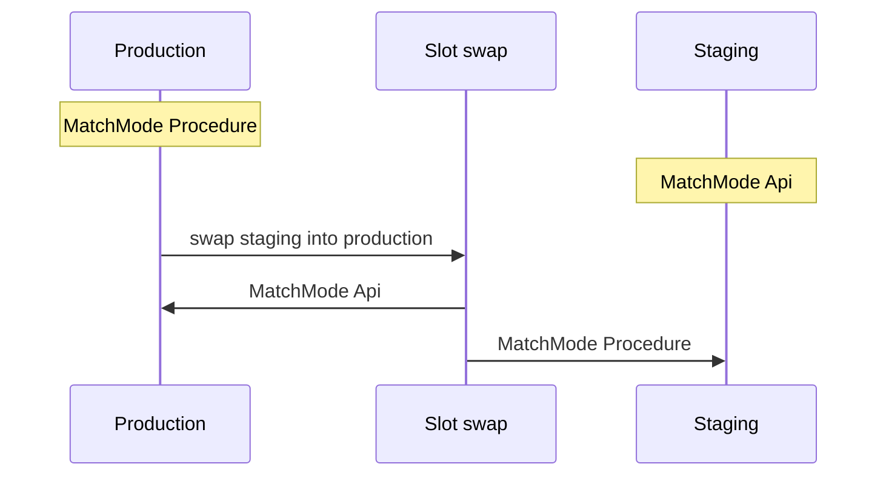

# Slot flow

One Windows plan in UK South hosts the desk, the staging slot, and the match API. The slot has no plan of its own. Azure SQL and Key Vault sit beside the plan. Both slots read SQL through the same Key Vault reference.

`MatchMode` is the setting a swap carries. Everything in `slotConfigNames` stays where it was.

## What shares the plan

Production calls `dbo.usp_MatchInvoice` and shows £1,224.00. Staging calls `POST /match` and shows £612.00. The API has no slot. Its connection setting is `ConnectionStrings__Northline`, the ASP.NET Core name for the same Key Vault reference.

## What a swap exchanges

`SqlConnection`, `MatchApiUrl`, Application Insights, and `WEBSITE_RUN_FROM_PACKAGE` are in `slotConfigNames`. Those six settings do not move. After the swap, production calls the match service. Migration 002 then drops the procedure, so the staging slot, now on `Procedure`, reports that the procedure is gone.

The command that performs this swap is the promote job in `.github/workflows/deploy.yml`.